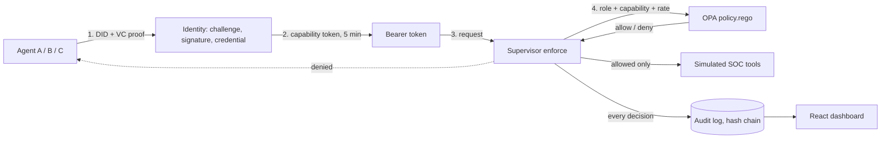

# Decentralized Identity and Capability-Based Authorization Framework for Autonomous Cybersecurity Agents

AI security agents must never act freely. A **FastAPI Supervisor** stands in front of every action. For each
request it (1) verifies the agent's identity (DID + Verifiable Credential), (2) checks a short-lived capability
token (one action on one resource), (3) asks **Open Policy Agent** for the final decision, (4) runs the action on a
**simulated** SOC tool only if allowed, and (5) writes every decision, allowed or denied, to a tamper-evident audit
log. An agent's ability to *suggest* an action is separate from its authority to *execute* it.

| Agent | Role | May | May not |
|---|---|---|---|
| A - Log Analyst | `log_analyst` | read logs, report IPs with 3+ failed logins | block anything |
| B - Threat Detector | `threat_detector` | rank threats by severity | block or isolate |
| C - Incident Responder | `incident_responder` | block IPs, isolate hosts (not protected ones, max 5/min) | read logs |

## Architecture



## Folder structure

```
soc-agent-framework/
├── main.py                 API: token + agent endpoints
├── enforcement.py          the single enforcement point (enforce)
├── policy.rego             OPA policy
├── agent_a.py agent_b.py agent_c.py soc_tools.py
├── tokens.py               capability tokens (EdDSA, 5 min)
├── identity/               did.py registry.py issuer.py auth.py  (DID + VC, no blockchain)
├── config.py db.py models.py audit.py revocation.py
├── admin.py demo.py        admin endpoints, DEV-ONLY simulator
├── client_lib.py           agent-side helpers
├── scripts/                create_agents.py agent_client.py
├── tests/                  test_identity.py test_tokens.py test_audit.py
├── eval/                   scenarios.py run_eval.py report.py
├── dashboard/              React + TypeScript (Vite)
├── Dockerfile docker-compose.yml .env.example Makefile run.ps1
└── README.md DEMO.md REPORT_OUTLINE.md
```

## Setup (local development)

You need Python 3.11+, Node 20+ and Docker (for OPA; or install the `opa` binary yourself).

**Windows PowerShell**
```powershell
.\run.ps1 setup          # venv, packages, .env files, agents, npm install
# edit .env and dashboard\.env: set the SAME long random ADMIN_KEY in both
.\run.ps1 dev-api        # terminal 1: starts OPA (Docker) + API on :8000
.\run.ps1 dev-ui         # terminal 2: dashboard on http://localhost:5173
```

**Linux / macOS**
```bash
make setup
# edit .env and dashboard/.env: set the SAME long random ADMIN_KEY in both
make dev-api             # terminal 1
make dev-ui              # terminal 2
```

Without the helper scripts: `python -m venv .venv`, activate it, `pip install -r requirements.txt`, copy
`.env.example` to `.env`, `python scripts/create_agents.py`, start OPA
(`docker compose up -d opa` or `opa run --server --addr :8181 policy.rego`), then
`uvicorn main:app --reload --port 8000`.

## Setup (everything in Docker)

```bash
cp .env.example .env     # set ADMIN_KEY and POSTGRES_PASSWORD   (PowerShell: Copy-Item)
docker compose up --build -d
docker compose exec api python scripts/create_agents.py
```
Dashboard: http://localhost:5173, API docs: http://localhost:8000/docs. Keys and agent files are stored in `./data`.
(`make start` / `.\run.ps1 start` do the same.)

## API

| Method | Path | Who may call |
|---|---|---|
| GET | `/health` | anyone |
| GET | `/api/v1/did/{did}` | anyone (public DID Document) |
| POST | `/api/v1/auth/challenge`, `/api/v1/auth/verify` | any agent (identity proof) |
| POST | `/api/v1/token` | agent with a valid DID + credential proof |
| GET | `/api/v1/agent-a/report` | token with `read_logs` (Log Analyst) |
| GET | `/api/v1/agent-b/threats` | token with `report_threat` (Threat Detector) |
| POST | `/api/v1/agent-c/block` `{ip}` | token with `block_ip` (Incident Responder) |
| POST | `/api/v1/agent-c/isolate` `{host}` | token with `isolate_host` (Incident Responder) |
| GET | `/api/v1/soc/blocked` | anyone (read-only simulated state) |
| POST | `/api/v1/admin/revoke` `{jti}` | admin (`x-admin-key`) |
| POST | `/api/v1/admin/reset-state` | admin (dev/eval only) |
| GET | `/api/v1/audit`, `/audit/stats`, `/audit/verify-chain` | admin |
| GET | `/api/v1/agents`, `/api/v1/policy` | admin |
| POST | `/api/v1/demo/run/{scenario}` | admin, **DEV ONLY** |

Status codes: `401` bad identity/token, `403` denied by capability or policy, `422` invalid input,
`503` OPA or audit log unavailable (fail closed). Every response from a protected endpoint carries
`X-Decision-Time-ms`.

## Demo (short version, see DEMO.md)

```
python scripts/agent_client.py log_analyst GET /api/v1/agent-a/report                 # 200
python scripts/agent_client.py log_analyst POST /api/v1/agent-c/block ip=203.0.113.5   # 403
python scripts/agent_client.py incident_responder POST /api/v1/agent-c/block ip=203.0.113.5   # 200
```

## Tests

```
pytest -v                      # needs no database setup; start OPA to run the policy tests too
pytest tests/test_identity.py  # Phase 3
pytest tests/test_tokens.py    # Phase 4 (tests marked needs_opa skip themselves if OPA is down)
pytest tests/test_audit.py     # Phase 5
```
The tests use temporary keys and a temporary database, never your real ones.

## Evaluation

```
python eval/run_eval.py        # 257 scenarios x 5 runs, 4 server variants, ~2-4 minutes
```
Outputs go to `eval/output/`: `results.csv`, `summary.json`, `results.md` and four PNG charts.
It starts its own servers: the real system, two weak baselines (`header_only`, `none`) and a "OPA is down" variant.

Results (fill in from your own run; paste `eval/output/results.md`):

| Metric | Value |
|---|---|
| Accuracy / precision / recall | *run the evaluation* |
| False-positive rate / false-negative rate | *run the evaluation* |
| p50 / p95 / p99 total decision time (ms) | *run the evaluation* |
| Attacks succeeding: full / header_only / none | *run the evaluation* |

## Known Limitations

- **Simulated SOC:** `soc_tools.py` only changes variables in memory; no firewall or production SOC is touched.
- **DID/VC as concepts, no blockchain:** DIDs are `did:example:*` strings, DID Documents live in a local JSON file,
  and credentials are simplified JWT-VCs. The Ed25519 cryptography itself is real.
- **Single-node demo:** nonces, the rate-limit window and the simulated SOC state are in memory (lost on restart,
  not shared between servers). Private keys are unencrypted PEM files.
- The hash chain proves edits and deletions in the middle of the log, but deleting the *last* rows is not detectable
  without an external anchor.
- The dashboard bundles the admin key into the browser code: development only.
- `demo.py`, `admin/reset-state` and the `SECURITY_MODE` baselines exist only for demonstrations and the evaluation.
# EDI
